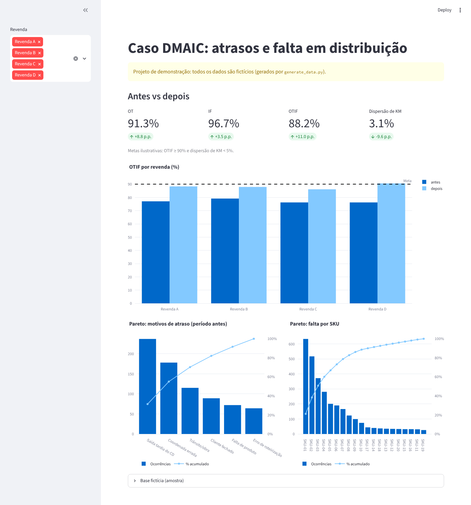

# Caso DMAIC simulado: atrasos e falta em distribuição

Projeto de demonstração em Python que aplica o ciclo **DMAIC** (Lean Six Sigma) a uma operação de distribuição com quatro revendas.

> **Aviso:** todos os dados são **100% fictícios**, gerados por `generate_data.py` com seed fixa. Nenhuma informação, nome ou número de empresa real foi usado.

## O que o projeto mostra

- **Measure:** OT (no prazo), IF (completo), OTIF (OT e IF na mesma linha) e dispersão de KM, calculados com Pandas de forma vetorizada.
- **Analyze:** Pareto dos motivos de atraso e da falta por SKU.
- **Improve/Control:** comparação antes vs depois por revenda contra metas ilustrativas (OTIF ≥ 90%, dispersão de KM < 5%).

Resultado na simulação: OTIF de 77,2% para 88,2% e dispersão de KM de 12,7% para 3,1%.



## Como rodar

```bash
pip install -r requirements.txt
python generate_data.py        # gera entregas.csv e faltas_sku.csv
streamlit run app.py
```

## Estrutura

| Arquivo | Função |
| --- | --- |
| `generate_data.py` | Simula 4.320 entregas "antes" e 4.320 "depois" (seed 42) e imprime os indicadores |
| `app.py` | Dashboard Streamlit com KPIs, OTIF por revenda e Paretos |
| `entregas.csv`, `faltas_sku.csv` | CSVs fictícios gerados |

## Stack

Python, Pandas, NumPy, Streamlit e Plotly.
